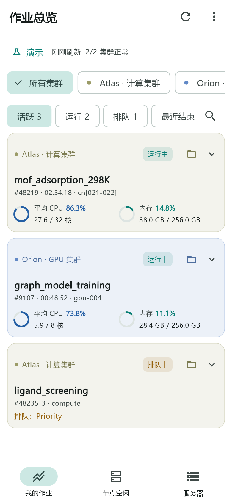
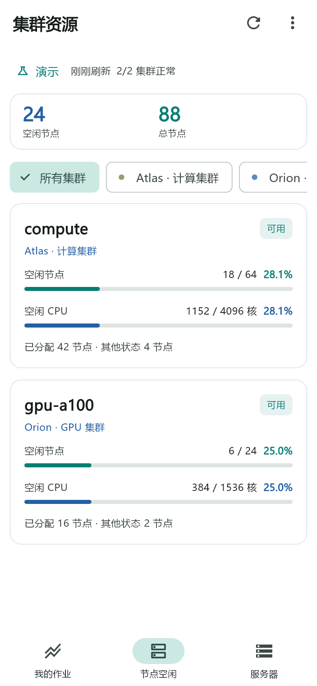
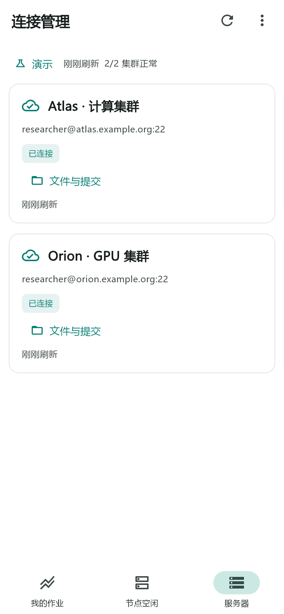

# Slurm 集群监控

Android 多集群 Slurm 监控工具，支持作业查询、桌面组件、远程文件浏览和 VASP/Gaussian 优化分析。

## 界面

| 我的作业 | 节点空闲 | 连接管理 |
| --- | --- | --- |
|  |  |  |

[深色界面](docs/images/dashboard-dark.png) · [桌面组件](docs/images/desktop-widget.png)

## 功能

- 多服务器 SSH 连接，支持密码和私钥认证。
- 作业状态、最近 7 天完成记录、搜索和任务通知。
- 分区空闲节点、CPU 和内存使用情况。
- SFTP 文件浏览、文本查找和三维结构预览。
- VASP/Gaussian 优化曲线与震荡趋势检查。
- 当前目录终端和 Slurm 任务提交。
- 桌面组件、明暗主题和宽屏布局。

## 使用

从 [Releases](https://github.com/white1102hue/slurm-cluster-monitor/releases) 下载 APK，安装后添加服务器并核验 SSH 主机指纹。内网服务器需先连接相应网络或 VPN。

支持 Android 7 及以上。详细操作见 [使用说明](docs/USAGE.md)。

## 构建

使用 Flutter 和 JDK 17，依赖版本见 [pubspec.yaml](pubspec.yaml)。

```sh
flutter pub get
flutter build apk --release
```

安装包位于 `build/app/outputs/flutter-apk/app-release.apk`。

[测试与构建](docs/TESTING.md) · [版本记录](CHANGELOG.md)

## 许可证

[MIT License](LICENSE)
