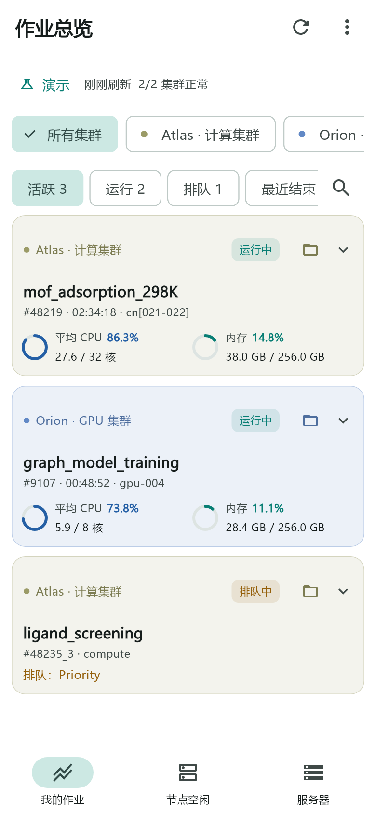
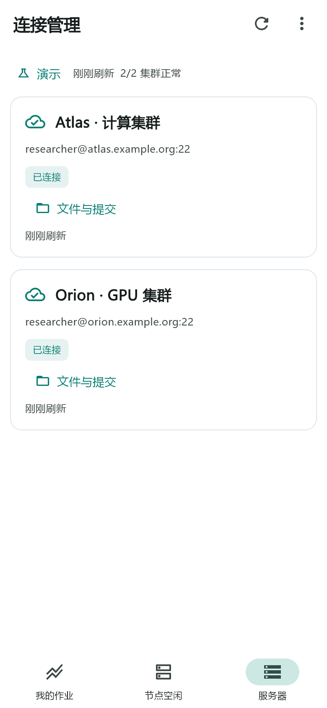

# GitHub 上传说明

整理日期：2026-10-31。适用版本：Slurm 集群监控 1.9.0 (16)。

本文件指导你把**脱敏后的源码副本**上传到自己的 GitHub 仓库。尚未创建远端仓库或进行任何上传。

## 1. 使用哪个目录

解压新的 `slurm_cluster_monitor_github.zip`，进入其中的 `slurm-cluster-monitor` 目录。这一层应直接包含 `README.md`、`pubspec.yaml`、`lib/`、`android/`、`test/` 和 `docs/`。

**上传该目录内的源码文件。不要上传旧源码压缩包、原开发工作区或上一级交付目录。** 新包不带旧 `.git` 历史、本机 SDK、服务器配置、测试运行目录和签名私钥。

```text
slurm-cluster-monitor/      ← 在这一层初始化仓库
├── README.md
├── CHANGELOG.md
├── .gitignore
├── .gitattributes
├── pubspec.yaml
├── pubspec.lock
├── lib/
├── android/
├── web/
├── test/
├── tool/
├── scripts/
└── docs/
    ├── GITHUB_UPLOAD.md
    ├── PRIVACY_REVIEW.md
    └── images/
```

准备 Git 和 GitHub 账号。以下命令里的 `YOUR_GITHUB_USERNAME`、`YOUR_GITHUB_NOREPLY_EMAIL` 均为占位符，执行前替换；不要把密码或 token 填进源码、远端 URL 或 README。

## 2. 新建空仓库

在 GitHub 新建仓库，建议名称 `slurm-cluster-monitor`，描述可使用：

> Flutter Android app for monitoring Slurm jobs, browsing files over SFTP, and inspecting VASP/Gaussian calculations.

按需要选择可见性。首次导入这份代码时，不在 GitHub 上预先生成 README、`.gitignore` 或 LICENSE，避免与已有文件产生初始历史冲突；许可证由你选择后补充。[GitHub 官方导入流程](https://docs.github.com/en/migrations/importing-source-code/using-the-command-line-to-import-source-code/adding-locally-hosted-code-to-github)

## 3. 首次提交与推送

在解压得到的 `slurm-cluster-monitor` 目录打开终端，执行：

```sh
git init -b main
git config --local user.name "YOUR_GITHUB_USERNAME"
git config --local user.email "YOUR_GITHUB_NOREPLY_EMAIL"
```

到 GitHub **Settings → Emails** 查看并复制自己的 no-reply 地址；不要猜测地址。此设置只影响当前仓库，后续公开提交会包含你选择的作者名及邮箱。[GitHub 提交邮箱说明](https://docs.github.com/en/account-and-profile/how-tos/email-preferences/setting-your-commit-email-address)

按明确的目录清单暂存：

```sh
git add .gitignore .gitattributes .metadata analysis_options.yaml pubspec.yaml pubspec.lock README.md CHANGELOG.md lib android web test tool scripts docs
git update-index --chmod=+x android/gradlew
git status --short
git diff --cached --stat
```

确认暂存列表中只有项目源码、文档和示例图片，没有 `.env`、`key.properties`、私钥、fixture 运行数据、SDK、缓存或安装包。不要用 `git add -f` 强行加入被忽略的文件。

```sh
git commit -m "Add Slurm cluster monitor 1.9.0"
git remote add origin https://github.com/YOUR_GITHUB_USERNAME/slurm-cluster-monitor.git
git push -u origin main
```

跟随 Git 的登录提示完成认证。这里提供的是操作说明，不会替你执行提交或推送。上传后，仓库首页应直接显示应用介绍和下面这样的图片表格。

## 4. 图片与 README 的显示

图片随仓库保存在 `docs/images/`；不要使用本机绝对路径、临时链接或私人云盘链接。README 已使用相对路径，可直接在 GitHub 渲染，无需另建图床。

| 作业总览示例 | 连接管理示例 |
| --- | --- |
|  |  |


在根目录 README 中添加图片可以使用：

```markdown

```

若图片不显示，核对文件是否已提交、大小写是否完全一致，以及相对路径是从当前 Markdown 所在目录计算。当前上传说明位于 `docs/`，因此它使用 `images/dashboard.png`。

## 5. 不使用命令行时

也可使用 GitHub 网页的 **Add file → Upload files**。源码文件数量超过一批上传上限，应按顶层目录分批，保留 `lib/`、`android/`、`docs/` 等目录名；根目录的隐藏文件也必须上传。网页上传当前每批最多 100 个文件，单文件上限为 25 MiB，完整导入更适合使用上面的 Git 方式。[GitHub 网页上传规则](https://docs.github.com/en/repositories/working-with-files/managing-files/adding-a-file-to-a-repository)

不要仅把源码 ZIP 上传为一个文件，否则 GitHub 不能直接展示源码目录和 README 中的本地图片。

## 6. 单独发布 APK

源码上传完成后，在本机按 [测试与构建](TESTING.md) 的公开安装包流程生成 APK，核对版本和签名。APK 作为 **Release 附件**发布，不提交到源码历史。若使用这次整理同时提供的安装包，选择文件名含 `-public` 的重建版；不要复用旧 APK。

1. 进入仓库 **Releases**，创建一个草稿发布。
2. 标签使用 `v1.9.0`，标题使用 `Slurm 集群监控 1.9.0`。
4. 附加 APK 与对应的 SHA256 校验文件，核对后再发布。

GitHub 支持在 Release 中附加二进制文件；先建立草稿可便于完整核对附件。[GitHub 发布说明](https://docs.github.com/en/repositories/releasing-projects-on-github/managing-releases-in-a-repository)

Windows PowerShell 计算 APK 内容哈希：

```powershell
Get-FileHash -LiteralPath 'build/app/outputs/flutter-apk/app-release.apk' -Algorithm SHA256
```

不要把签名私钥、`android/key.properties` 或私钥口令作为 Release 附件上传。APK 的公开签名证书/指纹与用于签名的私钥是不同材料。

## 7. 后续更新与隐私

新截图仍使用演示数据，并检查窗口标题、终端路径、通知栏和图像元数据。故障报告只提供必要的脱敏信息；不要发布实际账号、IP、工作目录、认证日志或原始配置。

`.gitignore` 只防止普通暂存操作误收文件，不能清除已经提交的内容。如果曾公开真实密码、token 或私钥，应先撤销/轮换，再按 GitHub 的历史清理指南处理；本新包没有继承旧历史。[GitHub 敏感数据处理说明](https://docs.github.com/en/authentication/keeping-your-account-and-data-secure/removing-sensitive-data-from-a-repository)

本次已处理的具体范围见 [公开副本脱敏记录](PRIVACY_REVIEW.md)。
